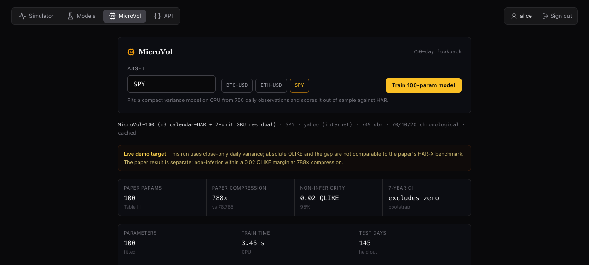

# ORACLE — Economic Scenario Engine

Frontend on GitHub Pages, backend (FastAPI) on Render.

- **App:** https://neksand.github.io/oracle/
- **API:** https://oracle-api-rvuq.onrender.com/docs

## Demo login

The app is seeded with a demo user and an admin user on first boot; use the demo
credentials shown in the login screen (they are not published here). Sign-in may take
up to ~30 s on the free Render plan while the API wakes up.

## MicroVol Studio — compact CPU volatility model

The `MicroVol` tab trains a compact volatility model on the server CPU in seconds:
a 19-parameter calendar-HAR backbone plus a 2-unit GRU residual, CPU-only, no CUDA.
If PyTorch is unavailable (or training fails) the run reports `fallback: true` and
serves the 19-parameter calendar-HAR only — it never claims the 100-parameter model.

- Backend: `POST /api/research/microvol` with `{"symbol": "SPY", "lookback_days": 750}`.
- Frontend: `frontend/src/components/UI/MicroVolPanel.tsx`.
- Model: `backend/app/research/microvol.py`.

### Paper protocol vs live demo

Two different things share the tab; the UI keeps them in separate cards:

- **Paper protocol (static, Table III).** Flat H=4 calendar residual, 116 parameters —
  679× fewer than the 78,785-parameter RCM. BTC/ETH/SOL asset-mean QLIKE gaps vs RCM at
  H=4: 5-year −0.0068 [−0.0299, +0.0117], 7-year −0.0111 [−0.0370, +0.0084], disjoint
  −0.0431 [−0.1243, +0.0196]; SPY +0.0366 (RCM better). Every crypto date-clustered 95%
  interval includes zero, i.e. parity at 679× compression, not dominance. TSR-100
  (100 parameters, 788×) is exploratory, not confirmatory. These numbers are sourced
  constants, not a live run.
- **Live demo.** Trains TSR-style m3 + GRU on the requested asset from 750 daily closes
  with a close-only daily-variance target and a 70/10/20 chronological split. Its
  absolute QLIKE and gap are not comparable to the paper protocol (demo split ≠ paper
  split); the panel says so. Gap convention everywhere is QLIKE(model) − QLIKE(baseline),
  so negative = model better. Crypto is annualised with 365, equities with 252.



## Local run

```bash
# backend
cd backend && pip install -r requirements.txt
uvicorn app.main:app --reload --port 8000

# frontend
cd frontend && npm install && npm run dev   # http://localhost:5173
```

Vite proxies `/api` and `/health` to `127.0.0.1:8000`, so no env vars are needed locally.

## Deploy

1. **Frontend** — push to `main`; `.github/workflows/pages.yml` builds `frontend/` and publishes it to Pages.
2. **Backend** — Render Blueprint ([render.yaml](render.yaml)):
   https://render.com/deploy?repo=https://github.com/Neksand/oracle
   The free plan sleeps after 15 min idle; the first request after that takes ~30 s.

The Render service is `oracle-api-rvuq` (the plain `oracle-api` subdomain was already taken).
Its URL is set as the repository variable `VITE_API_BASE_URL`
(Settings → Secrets and variables → Actions → Variables); the Pages workflow bakes it into
the build, so changing the backend URL only requires updating that variable and re-running
the workflow.

## Notes

- `CORS_ORIGINS` env var on the backend controls allowed browser origins (defaults include
  `https://neksand.github.io`).
- Render's filesystem is ephemeral: the SQLite demo DB lives in `/tmp` and is re-seeded on
  every deploy/restart. Data you create in the UI will not survive a restart.
